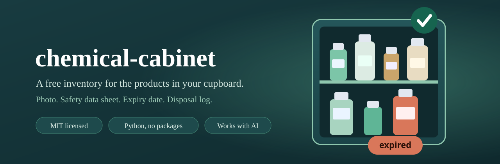
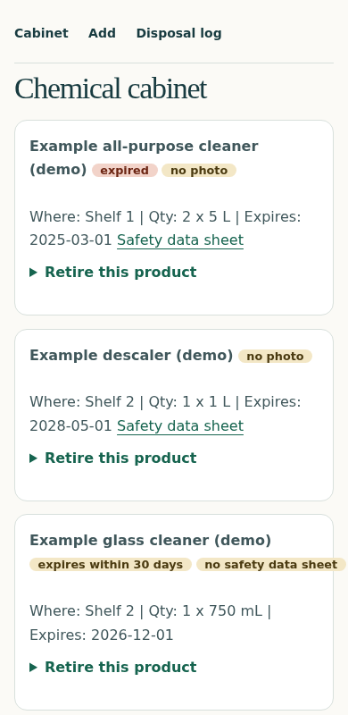

<p align="center">
  
</p>

# chemical-cabinet

[](https://github.com/HALCONDEORO/chemical-cabinet/actions/workflows/test.yml)

[Changelog](CHANGELOG.md) · [Project website](https://halcondeoro.github.io/chemical-cabinet/) · [Run it](#run-it) · [Use it with an AI assistant](docs/AI-AGENTS.md) · [Other tools](docs/ALTERNATIVES.md)

A free, self-hosted inventory for the chemical products kept in a cupboard or store room by an association or a small business. For each product you record a photo, the safety data sheet (PDF), where it is kept, the quantity, and the opened and expiry dates. The cabinet page flags what needs attention. When something is thrown away you retire it, and the reason and method go into a disposal log.

Python standard library only. No accounts, no external services, no tracking. MIT licensed.

**This is a tracking aid.** It does not check legal compliance, does not tell you which products can be stored together, and does not replace the manufacturer's safety data sheet, a written risk assessment or your national regulator's guidance.

## Start here

| Your task | Read first | What to check |
| --- | --- | --- |
| Try it on one computer | [Run it](#run-it) | Opens on `localhost`, data in one folder |
| Use it from a phone | [Using it from a phone](#using-it-from-a-phone) | Same Wi-Fi, password and HTTPS in front |
| Let an AI assistant read the cabinet | [docs/AI-AGENTS.md](docs/AI-AGENTS.md) | Read-only by default, local, no network port |
| Compare with other tools | [docs/ALTERNATIVES.md](docs/ALTERNATIVES.md) | Mostly lab tools, different licenses |
| Report a security problem | [SECURITY.md](SECURITY.md) | Private report first |

## What it does

- **One page per cupboard.** Every product with location, quantity, opened and expiry dates.
- **Photo and safety data sheet.** Take the photo from a phone, attach the PDF sheet to the product.
- **Review flags.** Expired, expires within 30 days, no expiry date, no safety data sheet, no photo.
- **Disposal log.** Retire a product with a reason and how it was disposed of.
- **CSV export and print sheet.** `/export.csv` downloads the inventory (text that starts with `=`, `+`, `-` or `@` is neutralised so spreadsheets do not run it as a formula). `/review` is a printable checklist.
- **Assistant access.** An optional local [MCP server](docs/AI-AGENTS.md) lets an AI assistant list products and flags.



*Demo data only.*

## Run it

Python 3.9 or newer.

```
python -m chemical_cabinet --data ./data --port 8080
```

Open `http://localhost:8080` on the computer that runs it. Data (SQLite database and uploads) lives in the `--data` folder: copy it to back up.

### Using it from a phone

By default the app only listens on `127.0.0.1`, so a phone cannot reach it. To use it from a phone on the same Wi-Fi, run it on a computer or small server in the building with `--host 0.0.0.0` (or that machine's LAN address) and open `http://<that machine's address>:8080` on the phone. Browsers usually only allow the camera on HTTPS pages, so the better setup is a reverse proxy that adds a password and HTTPS. If you reach it by a name such as `cabinet.local`, start it with `--allowed-host cabinet.local`. Never forward the port to the internet.

### Security model

The app has **no login**: anyone who can reach the port can read and change the inventory. Keep it on a trusted network or behind a reverse proxy with authentication. The app does refuse requests from other web sites open in your browser: it checks the `Host` header (against DNS rebinding), the `Origin` of every change, and a form token. Uploads are limited to JPEG, PNG, WebP and PDF files, checked by content, up to 25 MB.

## Other tools

Free chemical inventory tools already exist, mostly for university labs. See [docs/ALTERNATIVES.md](docs/ALTERNATIVES.md). No code from them was copied.

## Test

```
python -m unittest discover -s tests -v
```

## Status

Early version (0.1). Ideas welcome as issues: export to CSV, a printable review sheet, translations, optional login.

## License

MIT, see [LICENSE](LICENSE).
